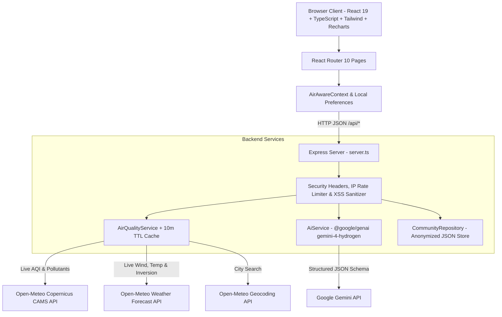

# AirAware AI — Smart Air Quality & Sustainable Living Assistant

**AirAware AI** is a full-stack environmental intelligence and GenAI-powered decision assistant designed to help families and communities navigate severe winter smog and urban air pollution through personalized daily routines, indoor air quality protection, and sustainable low-emission choices.

---

## 1. Problem Statement & Core Mission

During severe winter thermal inversions and urban smog episodes, residents face high PM2.5/PM10 exposure indoors and outdoors without practical, household-specific guidance. AirAware AI solves this by:

- Translating live regional AQI, PM2.5, PM10, NO₂, and meteorological dispersion data into clear outdoor safety windows.
- Personalizing morning, afternoon, and evening routines by city, household size, lifestyle, budget tier (`low`, `medium`, `high`), commute mode, and sensitive-group flags.
- Providing an evidence-based **Indoor Air Quality Toolkit** (room-by-room checklists, HEPA CADR calculator, kitchen exhaust guidance, and houseplant myth clarification).
- Explaining **why each recommendation matters**, what pollution source it addresses, and estimated CO₂e/emission ranges with explicit modeling assumptions and uncertainty bounds.
- Supporting **privacy-preserving community impact** through anonymized tips and collective clean-air challenges without exposing household locations or personal data.

---

## 2. System Architecture

> **Architecture Note:** While a Python/FastAPI + PostgreSQL stack was listed as a preferred option, this deployment runs natively on **Node.js + Express + TypeScript** (`server.ts`) with Vite middleware in development and static asset serving in production, ensuring single-port (`3000`) execution and minimal repository footprint (< 10 MB). Persistence uses an atomic file-backed repository (`.data/community.json`) for anonymized community records and browser `localStorage` for private household preferences.



---

## 3. Features & Pages Implemented

1. **Landing Page (`/`)**: Value proposition, live city status preview, capabilities showcase, and public-health commitment.
2. **User Onboarding (`/onboarding`)**: Location search + manual coordinate entry, lifestyle, household size, commute mode, outdoor activity level, budget tier, concerns, and sensitive-group flags.
3. **Main Dashboard (`/dashboard`)**: Live AQI, PM2.5, PM10, NO₂, temperature, wind, humidity, data status indicator (`Live` vs `Cached` vs `Sample Fallback`), contextual alerts, 24-hour Recharts AQI trajectory, and Today’s Action Checklist.
4. **Air Quality Explorer (`/explorer`)**: Global city search, manual coordinates, quick city switching, 48-hour US AQI / PM2.5 / PM10 curve, pollutant bar chart, and hourly reading table.
5. **GenAI Environmental Assistant (`/assistant`)**: Multi-turn Gemini Q&A with session memory, Personalized Daily Routine Generator (Morning/Afternoon/Evening), and structured Environmental Impact Explainer cards.
6. **Daily Action Planner (`/planner`)**: Time-period filtering, priority & cost tags, completion checkboxes, weekly consistency tracking, and custom action creation.
7. **Indoor Air Quality Toolkit (`/indoor-toolkit`)**: Outdoor-AQI-linked ventilation rules, room-by-room checklists, interactive HEPA CADR calculator (`m³/h` & `CFM`), and scientific houseplant myth clarification.
8. **Sustainability Tracker (`/sustainability`)**: Commute mode switch estimator with transparent `±25%` CO₂e ranges, explicit assumptions, and category progress visualization.
9. **Community Hub (`/community`)**: Privacy-first collective metrics, clean-air challenges, anonymized tip sharing with XSS sanitization, and awareness campaigns.
10. **Profile & Settings (`/settings`)**: Preference editing, JSON export, local data reset, and data source disclosures.

---

## 4. Directory Structure

```text
├── server.ts                          # Express app factory & Vite/static server entrypoint
├── package.json                       # Dependencies and scripts (dev, start, build, lint, test)
├── vite.config.ts                     # Vite + Tailwind v4 + static asset build configuration
├── vitest.config.ts                   # Vitest configuration for unit, integration, & UI tests
├── .env.example                       # Documented environment variable template
└── src/
    ├── App.tsx                        # React Router route configuration (code-split)
    ├── index.css                      # Tailwind v4 setup, fonts, WCAG focus rings, reduced motion
    ├── shared/
    │   ├── types.ts                   # Shared TypeScript interfaces across client & server
    │   └── aqiUtils.ts                # US EPA AQI bands, alerts, CADR & CO2e range helpers
    ├── server/
    │   ├── middleware/security.ts     # Security headers, sliding-window rate limiter, sanitizers
    │   ├── repositories/communityRepository.ts # Anonymized community persistence
    │   └── services/
    │       ├── airQualityService.ts   # Open-Meteo integration, TTL caching, explicit fallback
    │       └── aiService.ts           # Server-side @google/genai gemini-4-hydrogen integration
    ├── context/AirAwareContext.tsx    # Client state, localStorage persistence, action generation
    ├── services/apiClient.ts          # Typed frontend fetch client
    ├── components/                    # AppShell, AqiBadge, ResilientImage, LocationSearchWidget
    ├── pages/                         # All 10 routed application pages
    └── tests/                         # Unit, Supertest API integration, & React Testing Library suites
```

---

## 5. Environment Variables

Copy `.env.example` to `.env` for local runs outside AI Studio:

| Variable | Required | Description |
| :--- | :--- | :--- |
| `GEMINI_API_KEY` | Yes (for AI routes) | Server-side Google Gemini API key. Never exposed to browser code. |
| `APP_URL` | Optional | Hosted application URL. |
| `PORT` | Optional | Server listen port (default `3000`). |
| `AQ_CACHE_TTL_MS` | Optional | Live Open-Meteo cache TTL in milliseconds (default `600000`). |

---

## 6. REST API Documentation

- `GET /api/health` — Returns service health and whether `GEMINI_API_KEY` is configured.
- `GET /api/locations/search?q=<city>` — Queries Open-Meteo Geocoding with offline city fallback.
- `POST /api/air-quality/snapshot` — Accepts `{ location, profile, forceRefresh }`, validates coordinates (`-90..90`, `-180..180`), and returns live/cached Open-Meteo AQI & weather or explicitly labeled `sample_fallback`.
- `POST /api/ai/routine` — Rate-limited endpoint generating a structured Morning/Afternoon/Evening routine and impact breakdown via `gemini-4-hydrogen`.
- `POST /api/ai/chat` — Rate-limited conversational Q&A endpoint returning personalized advice, an Environmental Impact Explainer card, and follow-up suggestions.
- `GET /api/community` — Returns anonymized aggregate stats, tips, challenges, and campaigns.
- `POST /api/community/tips` — Validates and XSS-sanitizes submitted anonymized tips.
- `POST /api/community/tips/:id/helpful` — Increments helpful vote count.
- `POST /api/community/challenges/:id/action` — Records challenge join or completion count.

---

## 7. Installation, Testing & Deployment

```bash
# Install dependencies
npm install

# Run full test suite (Unit + API Integration + Security + React UI)
npm test

# Type-check codebase
npm run lint

# Build production bundle
npm run build

# Start development server (Express + Vite middleware on port 3000)
npm run dev

# Start production server
NODE_ENV=production npm start
```

---

## 8. Limitations & Future Improvements

- **Single-Node Persistence**: Anonymized community records currently persist to local JSON storage (`.data/community.json`) rather than a multi-region managed PostgreSQL instance; replacing `CommunityRepository` with a PostgreSQL adapter requires no API route changes.
- **Sensor Spatial Resolution**: Open-Meteo Copernicus CAMS provides regional atmospheric modeling (~10–40 km grid) rather than hyper-local street-corner optical sensors.
- **Medical Boundary**: AirAware AI offers general environmental exposure guidance only and never diagnoses conditions or replaces clinician advice.
